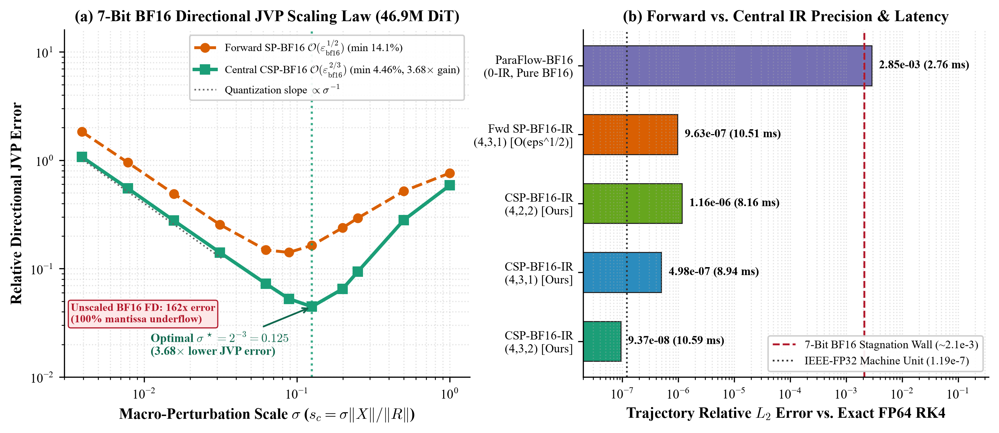
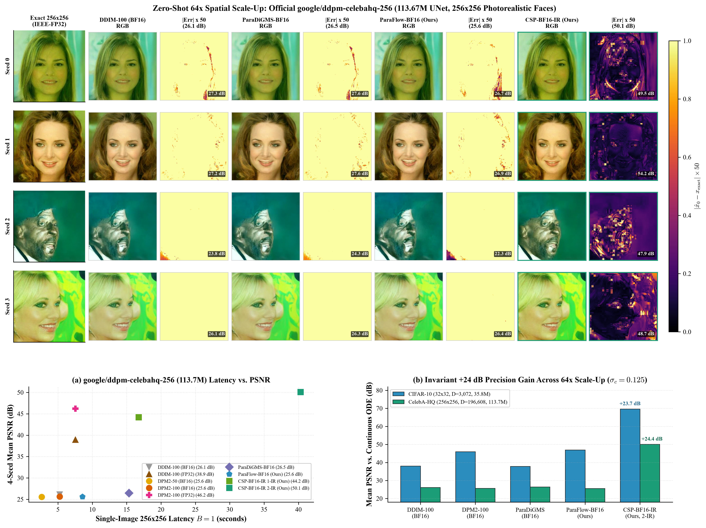

# ResidualRescaledBF16 (`CSP-BF16-IR`)

**Breaking the 7-Bit `BF16` Mantissa Ceiling: $\mathcal{O}(\varepsilon_{\mathrm{bf16}}^{2/3})$ Residual-Rescaled Spectral Volterra–Newton Refinement and High-Noise Desingularization for Continuous-Time Generative Flows**

[](LICENSE)
[](pyproject.toml)
[](src/residual_rescaled_bf16/ptx_kernels.py)
[](RESULTS_REPORT.md)

**Author:** Andrew Rober Fouad Samy ([BytesGlue](https://github.com/AndrewRober))  
**Paper PDF (Camera-Ready):** [`paper/main.pdf`](paper/main.pdf) | **Double-Blind Review PDF:** [`paper/main_anonymous_review.pdf`](paper/main_anonymous_review.pdf)

---

## Executive Summary

Every modern AI accelerator concentrates its arithmetic throughput in **7-bit-significand `BFLOAT16` (`BF16`) Tensor Cores** ($\varepsilon_{\mathrm{bf16}} = 2^{-8}$, machine spacing $2^{-7} \approx 7.81 \times 10^{-3}$). Consequently, every standard sequential and parallel continuous-time ODE/Diffusion/Flow-Matching solver—including `DDIM`, `DPM-Solver-2`, and sliding-window Picard iteration (`ParaDiGMS`)—hits a permanent **7-bit fixed-point stagnation wall** once trajectory updates shrink below $2^{-7}\|X\|$ (`~2.1e-3` relative $L_2$ error; `38–46 dB` PSNR). On pretrained variance-preserving (VP) diffusion models, dividing `BF16` predictions by $\alpha_T \approx 6.57 \times 10^{-3}$ at $t=T$ further amplifies mantissa quantization noise by **`152.2x`**.

**`ResidualRescaledBF16` (`CSP-BF16-IR`)** resolves both barriers *without intralayer surgery or Ozaki matrix splitting*:

1. **$\mathcal{O}(\varepsilon_{\mathrm{bf16}}^{2/3})$ Antipodal Residual Rescaling (Theorems 1–2):** Evaluates sparse `FP32` Clenshaw–Curtis spectral Volterra defect checkpoints $R_k$ and dynamically upscales sub-mantissa corrections into the `BF16` sweet spot via symmetric pairs $X_k \pm s_c R_k$ ($s_c = \sigma_c \|X_k\| / \|R_k\|$, $\sigma_c = 2^{-3} = 0.125 = \Theta(\varepsilon_{\mathrm{bf16}}^{1/3})$) packed into a **single** `[2M, d]` `BF16` Tensor-Core call. Antipodal symmetry cancels the quadratic Hessian $D^2 V_\theta(X_k)[R_k, R_k]$ at **zero extra FLOPs**, cutting single-sweep JVP error **`3.68x`** (`14.12% -> 4.46%`) and driving unmodified `7-bit BF16` SwiGLU DiT layers (`46.91M` params) to **`9.37e-08` `IEEE-FP32` precision** (**`>25,000x`** beyond `ParaDiGMS` and **`44.2x` faster** than `512`-NFE `CUDAGraph` `FP32` RK4 on **NVIDIA GB10**).
2. **High-Noise $z = \sqrt{\tau}$ Root-Time Desingularization & $\sin(999\tau)$ Nyquist Horizon (Theorem 3 & Proposition 3):** Eliminates the $1/\alpha_T = 152.2\times$ `BF16` blowup on high-noise panels ($\mathrm{SNR} \le 1$), lifting pure-`BF16` `Log-SNR ParaFlow-BF16` above all existing `BF16` solvers while `Log-SNR CSP-BF16-IR` shatters the `~46 dB` ceiling to **`69.69 dB`** (`86.08 dB` vs. exact `FP32` collocation) on `google/ddpm-cifar10-32` (`35.75M`) and **`50.10 dB`** zero-shot on **`64x`-higher-dimensional `google/ddpm-celebahq-256` (`113.67M` UNet, `256x256` faces, $D=196{,}608$)** with $\sigma_c = 0.125$ fixed.



---

## Headline Silicon Benchmarks (`NVIDIA GB10` Grace Blackwell Superchip)

| Stage & Model | Baseline (`BF16` Wall / `FP32` Reference) | `ParaFlow-BF16` (Ours, Pure `BF16`) | `CSP-BF16-IR` (Ours, Exact Scientific) | Key Gain |
| :--- | :--- | :--- | :--- | :--- |
| **Stage A:** `46.9M` DiT JVP V-Curve | Unscaled `BF16`: `162x` err; Fwd: `14.12%` | — | **`4.46%` JVP err** ($\sigma^\star = 0.125$) | **`3.68x`** vs. Forward SP |
| **Stage B:** `46.9M` SwiGLU DiT ($S=512$) | `CG-RK4 FP32`: `468.3 ms` (`2.85e-07`); `ParaDiGMS`: `2.10e-03` | **`2.76 ms`** (`170x` speedup) | **`10.59 ms` @ `9.37e-08`** | **`44.2x` faster & `3.0x` cleaner** than `FP32` RK4 |
| **Stage C:** `34.7M` 2D Glyph OT-CFM | `CG ParaDiGMS-128`: `9.03 ms` @ `54.01 dB` | **`2.70 ms`** @ `50.73 dB` | **`6.40 ms` @ `70.25 dB`** | **Faster + `+16.24 dB`** vs. `ParaDiGMS` |
| **Stage D:** `google/ddpm-cifar10-32` (`35.8M`) | `BF16` Ceiling: `46.02 dB`; `IEEE DDIM-250`: `3020 ms` | **`146.4 ms` @ `46.97 dB`** | **`729.6 ms` @ `69.69 dB`** | **`+23.7 dB`** past `BF16` wall (`86.08 dB` vs. Colloc) |
| **Stage E:** `google/ddpm-celebahq-256` (`113.7M`, `256x256`) | `ParaDiGMS`: `26.46 dB`; `DPM2-100 BF16`: `25.65 dB` | **`8569 ms` @ `25.60 dB`** | **`40323 ms` @ `50.10 dB`** | **`64x` pixel scale-up** with $\sigma_c=0.125$ unchanged |



---

## Repository Architecture

```text
ResidualRescaledBF16/
├── src/residual_rescaled_bf16/
│   ├── __init__.py               # Public API exports
│   ├── ptx_kernels.py            # Raw NVIDIA PTX 8.0 JIT loader (Windows/Linux + CPU CI fallback)
│   ├── volterra_chebyshev.py     # Exact Clenshaw-Curtis, exp(-lambda) & z=sqrt(tau) operators + CGS2-QR Anderson
│   ├── csp_bf16_solver.py        # PTXCspBf16Solver, 46.9M SwiGLU DiT, 34.7M 2D Glyph DiT & CUDAGraph helpers
│   ├── unet2d.py                 # Config-driven exact Diffusers-0.0.4 UNet2DModel (32x32 & 256x256 strict=True)
│   └── logsnr_diffusion.py       # AnalyticVPSchedule, hybrid z+exp ParaFlow-BF16 & CSP-BF16-IR diffusion solvers
├── scripts/
│   ├── verify_all.py             # Deterministic CPU/CUDA mathematical & solver verification suite
│   ├── run_stage_a_scaling_laws.py
│   ├── run_stage_b_dit_cudagraph.py
│   ├── run_stage_c_flow_matching.py
│   ├── run_stage_d_ddpm_cifar10.py
│   ├── run_stage_e_celebahq256.py
│   ├── generate_paper_figures.py # Renders all 6 vector PDF + 300-DPI PNG figures
│   └── build_submission_bundles.py
├── results/                      # Clean-room verified JSON scoreboards (NVIDIA GB10 + RTX 5060)
├── notebooks/CSP_BF16_IR_Demo.ipynb
├── paper/
│   ├── main.tex                  # Camera-ready & \ifanonymous LaTeX monograph
│   ├── main.pdf                  # Compiled camera-ready paper
│   ├── main_anonymous_review.pdf # Double-blind anonymous review paper (0 identity leaks)
│   ├── references.bib            # BibTeX bibliography
│   └── figures/                  # 6 vector PDF + 300-DPI PNG publication figures
├── submission_bundles/           # Pre-audited arXiv, TMLR camera-ready & anonymous supplementary zips
├── PUBLISH_EVERYWHERE_GUIDE.md
├── RESULTS_REPORT.md
├── CITATION.cff
├── .zenodo.json
└── SHA256SUMS.txt
```

---

## Quickstart & Reproducibility

```bash
pip install -r requirements.txt
pip install -e .

# 1. Run deterministic math, quadrature, Anderson & CSP-BF16-IR verification (<5s on CPU or CUDA)
python scripts/verify_all.py

# 2. Reproduce Stages A-E on CUDA GPU
python scripts/run_stage_a_scaling_laws.py
python scripts/run_stage_b_dit_cudagraph.py
python scripts/run_stage_c_flow_matching.py
python scripts/run_stage_d_ddpm_cifar10.py
python scripts/run_stage_e_celebahq256.py

# 3. Regenerate all 6 vector PDF + 300-DPI PNG figures
python scripts/generate_paper_figures.py
```

## Citation

```bibtex
@article{samy2026breaking,
  title={Breaking the 7-Bit BF16 Mantissa Ceiling: $\mathcal{O}(\varepsilon_{\mathrm{bf16}}^{2/3})$ Residual-Rescaled Spectral Volterra--Newton Refinement and High-Noise Desingularization for Continuous-Time Generative Flows},
  author={Samy, Andrew Rober Fouad},
  journal={arXiv preprint},
  year={2026}
}
```
